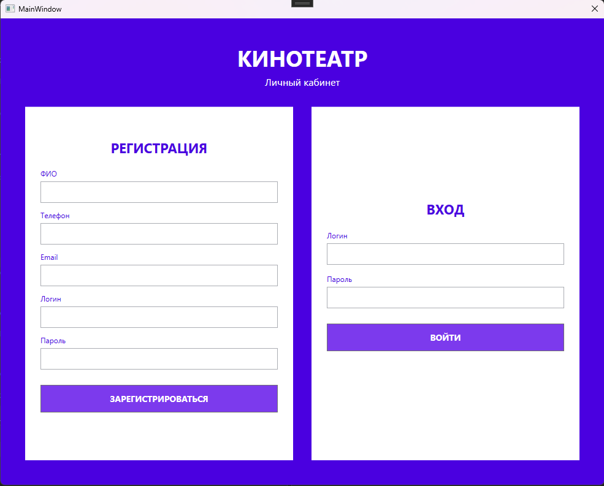
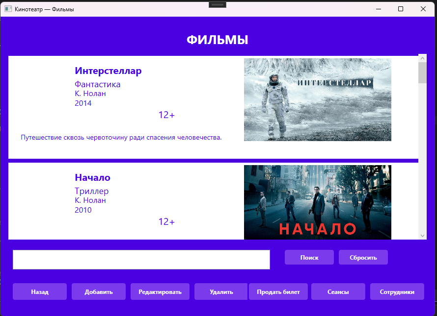
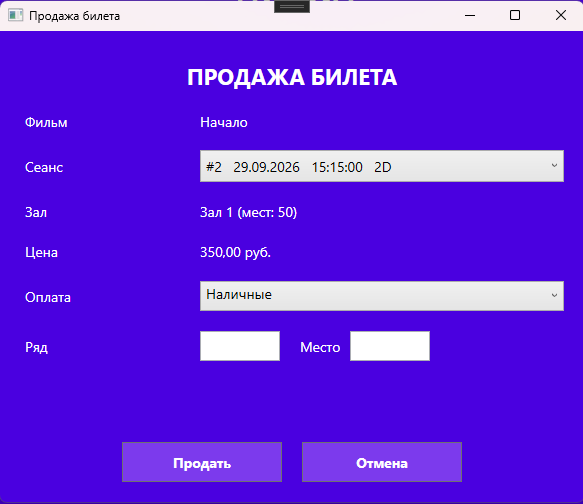
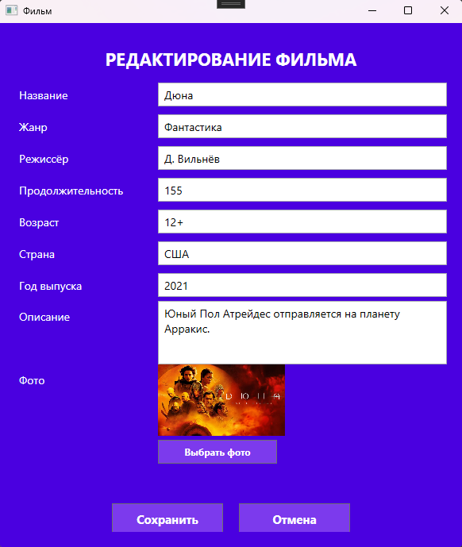
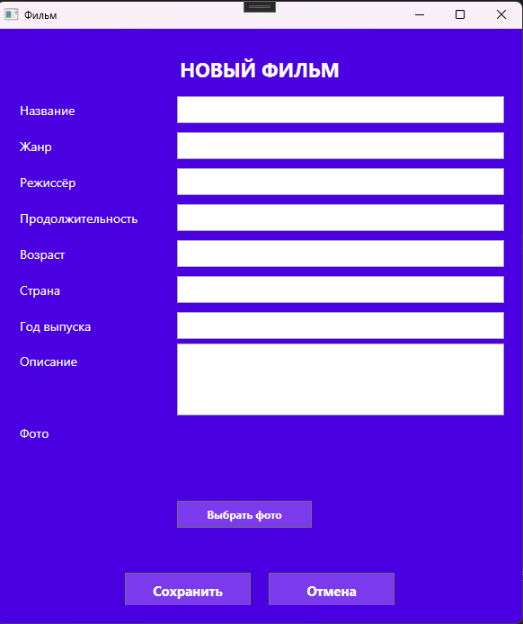
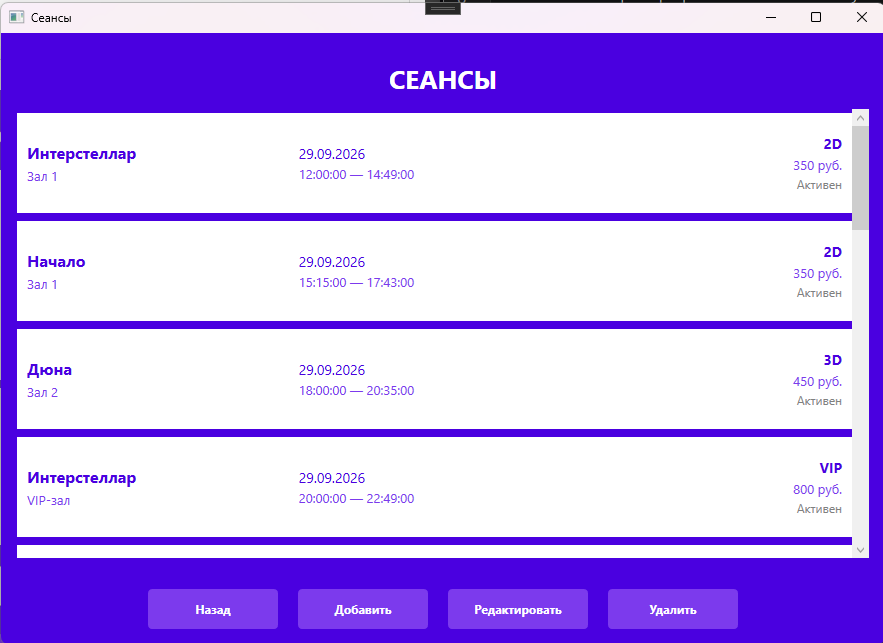
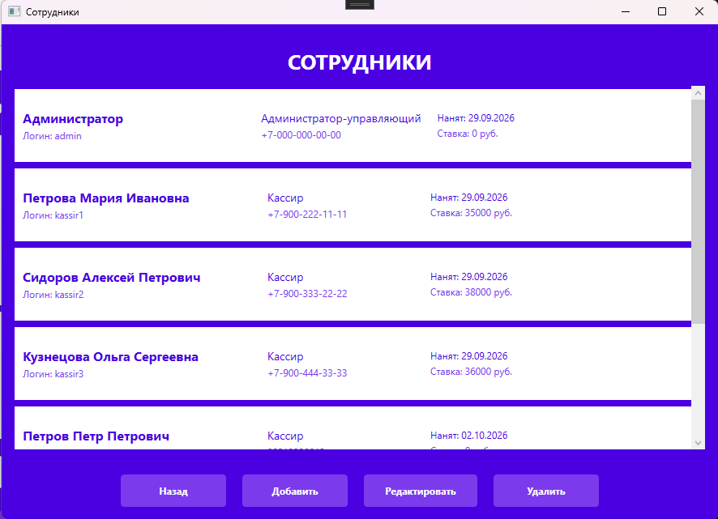

# Система управления кинотеатром

Этот проект представляет собой десктопное WPF-приложение для автоматизации деятельности кинотеатра. Программа позволяет вести учёт фильмов, управлять расписанием сеансов, продавать билеты и контролировать персонал. Приложение имеет строгое разграничение прав доступа и встроенную бизнес-логику (проверка занятости мест, контроль пересечения сеансов).

## Визуальная демонстрация















## Установка

1. **Клонируйте репозиторий:**
   ```bash
   git clone https://github.com/pavlovapi/cinema-LR-3-4.git
   cd cinema-LR-3-4

2. Откройте решение:
Откройте файл Cinema1.sln в Visual Studio (версия 2019 или 2022).

3. Восстановите NuGet-пакеты:
В Visual Studio нажмите правой кнопкой мыши на Solution -> Restore NuGet Packages (должен подтянуться Entity Framework 5.0).

4. Настройте базу данных:
 - Разверните базу данных в Microsoft SQL Server (используйте скрипты из Лабораторной работы №3).
- Откройте файл App.config в папке проекта.
- Измените строку подключения CinemaDBEntities2, указав имя вашего сервера SQL в параметре data source.

## Использование 

Запуск приложения
Запустите проект через Visual Studio (F5). Откроется окно авторизации.

Тестовые аккаунты:
- Администратор: Логин: admin, Пароль: 123
- Кассир: Логин: kassir1, Пароль: 123

## Роли пользователей

- Администратор-управляющий: Имеет полный доступ к системе. Может добавлять, редактировать и удалять фильмы, сеансы и сотрудников. Доступны все кнопки управления.

- Кассир: Имеет ограниченный доступ. Может просматривать фильмы, сеансы и продавать билеты. Кнопки редактирования и удаления скрыты.

## Продажа билета

1. Выберите фильм в главном окне и нажмите кнопку «Продать билет».

2. В открывшемся окне выберите сеанс из выпадающего списка.

3. Введите номер ряда и места.

4. Нажмите «Продать».

Ожидаемый вывод:

Если место свободно: всплывающее окно "Билет продан!".
Если место занято: ошибка "Это место уже занято на данном сеансе.".

## Структура проекта

- Cinema1.slnx — Файл решения Visual Studio.

- App.xaml — Точка входа в приложение.

- MainWindow.xaml — Окно авторизации и регистрации.

- DataWindow.xaml — Главное окно со списком фильмов (вывод постеров, поиск).

- TicketWindow.xaml — Окно оформления и продажи билета.

- SessiaListWindow.xaml / SessiaEditWindow.xaml — Окна для просмотра и редактирования расписания сеансов.

- SotrudnikListWindow.xaml / SotrudnikEditWindow.xaml — Окна управления персоналом.

- CinemaDB.edmx — Модель Entity Framework для связи с БД.

- BytesToImageConverter.cs — Конвертер для отображения фото (byte[]) из БД в компоненте Image.

## Дата

В качестве источника данных используется реляционная база данных Microsoft SQL Server, спроектированная в Лабораторной работе №3.

Основные таблицы:

- Filmy — Хранит информацию о фильмах (название, жанр, режиссер, постер в формате byte[]).

- Sessii — Расписание сеансов (дата, время начала/окончания, цена).

- Zaly — Информация о залах (название, вместимость, количество рядов).

- Bilety — Проданные билеты (ряд, место, стоимость, статус, ID сотрудника).

- Sotrudniki — Данные пользователей системы (ФИО, роль, логин, пароль).

## Лицензия

Этот проект распространяется под лицензией MIT.
